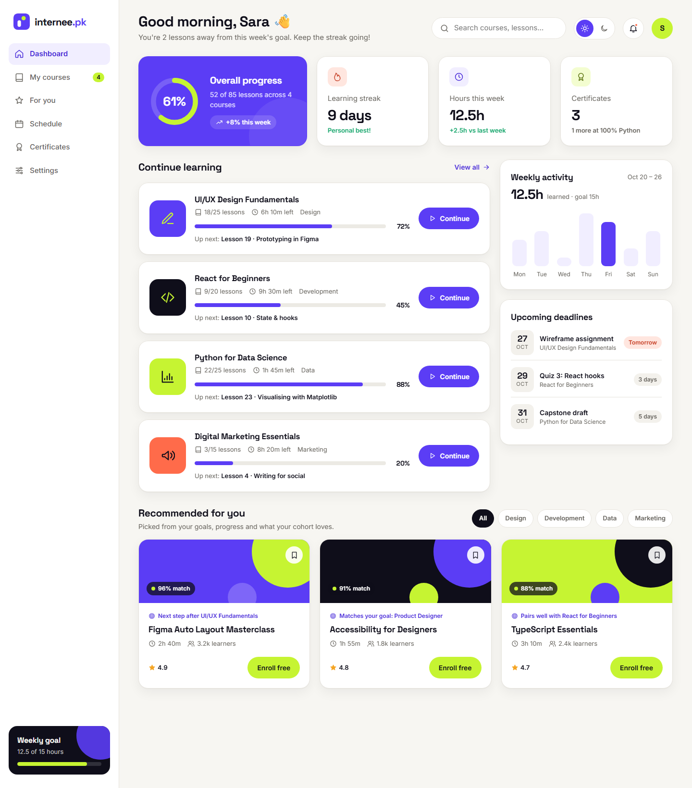
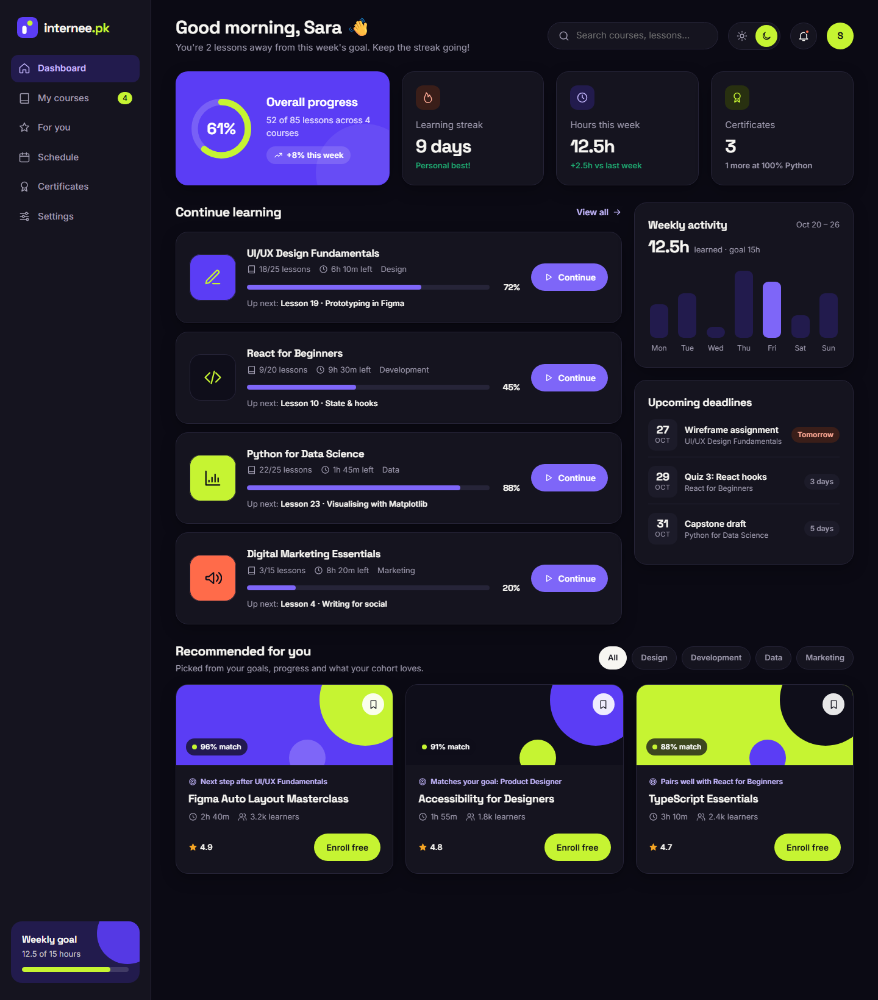
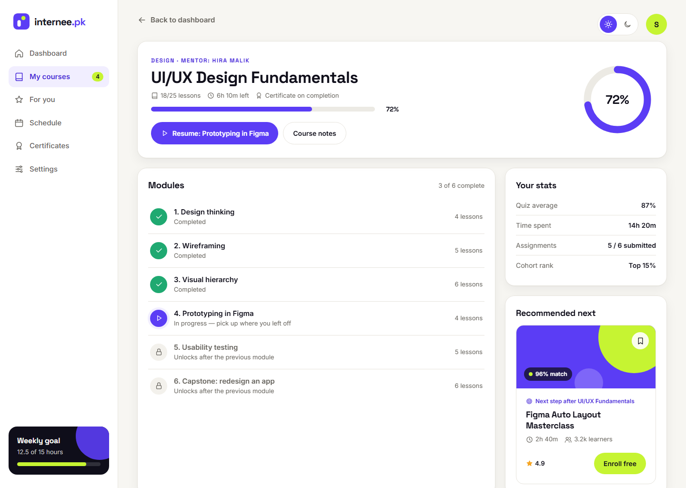
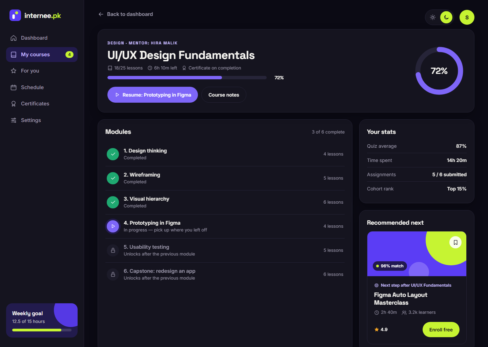

# Internee.pk LMS Dashboard Redesign

A redesign of the Internee.pk Learning Management System (LMS) dashboard, built to feel modern and easy to use.

**▶ Live interactive prototype:** https://mrjerry675.github.io/internee-lms-dashboard/

## Features

| Feature | What it does |
|---|---|
| **Course progress tracking** | An overall progress ring, a progress bar and the next lesson for every course, a weekly activity chart, a learning streak and upcoming deadlines. Each course has a module-by-module view showing what's done, in progress and locked. |
| **Personalised recommendations** | A "Recommended for you" row that explains *why* each course is suggested, e.g. "Next step after UI/UX Fundamentals". Each card shows a match score, filter chips, a save button and one-click enrolment. |
| **Dark / Light mode switch** | An animated switch in the top bar. It follows the system setting on the first visit, then remembers your choice. Both themes use matching colour tokens for good contrast. |

The design follows the [Internee.pk Branding Kit](https://github.com/mrjerry675/internee-branding-kit): Launch Violet, Spark Lime, Midnight Ink and Paper colours, with Space Grotesk and Inter fonts.

## Figma file

`figma-plugin/` contains a plugin that builds the whole prototype natively in Figma:

- **Auto Layout** on every screen, card, list and button.
- **Components with variants:**
  - Button (Style × Theme)
  - Theme Toggle (Mode)
  - Nav Item (Theme × State)
  - Stat Card
  - Course Card
  - Recommendation Card (Theme × State, with a hover interaction)
  - 24 icons
- **Prototype links:**
  - The theme switch Smart Animates between the Light and Dark screens.
  - Clicking a course card opens the course page.
  - "Back to dashboard" returns to the dashboard.
  - Hovering a recommendation card shows its hover state.
- **Colour and text styles**, plus an `LMS Theme` variable collection with Light and Dark modes. On a free Figma plan the collection only gets the Light mode.

To generate the file:

1. Open the **Figma desktop app** and create a new blank design file.
2. Go to **Menu → Plugins → Development → Import plugin from manifest…** and select `figma-plugin/manifest.json`.
3. Run **Internee.pk LMS Dashboard Generator**.
4. Open the **Prototype** page and press **▶ Present**.

## Screens

| Light | Dark |
|---|---|
|  |  |
|  |  |
